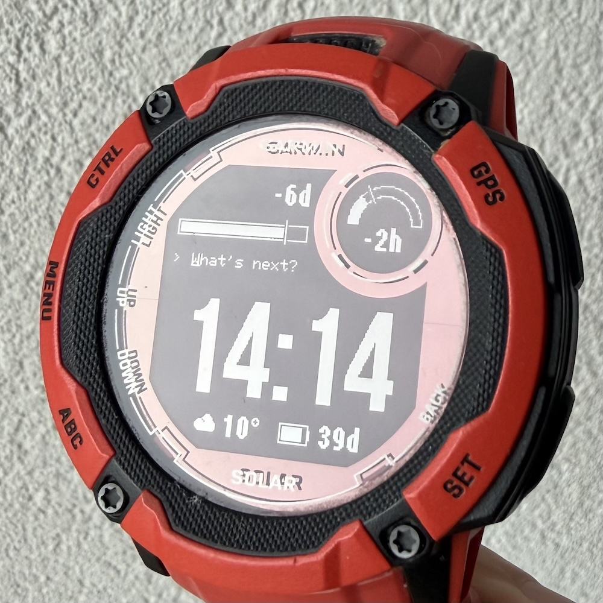
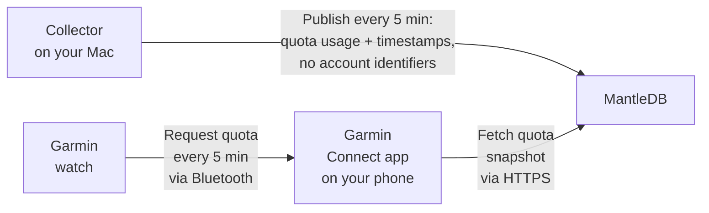

# Token Quota for Garmin Instinct 2X Solar

Check your remaining Codex subscription quota and time until reset from a Garmin Instinct 2X Solar watchface. It shows the five-hour and seven-day quota windows alongside a 24-hour clock, weather info and battery level. The included collector supports Codex only. You can also configure an existing public quota URL.



## How it works

A Python collector on your Mac reads quota from your signed-in Codex CLI and publishes a snapshot to [MantleDB](https://mantledb.sh/). The watch reads that snapshot through your phone using Garmin Connect.



**Your quota snapshot is public.** Anyone with its URL can read the remaining quota, reset times, and observation time. The collector does not publish prompts, conversations, or Codex authentication credentials. MantleDB receives the snapshot and the write token used to publish it; the token is saved locally in `.local/collector.json` and is not sent to the watch.

The collector and watch each check every five minutes. Readings can approach ten minutes old during normal operation, and sleep or connection problems can delay them further. The Mac must be awake and logged in for collection; the watch needs a Bluetooth connection to a phone with Internet access and Garmin Connect running in the background.

## Reading the watchface

- The circular gauge shows five-hour quota; the horizontal bar shows seven-day quota.
- White fill shows quota remaining. The thin outlined marker shows time remaining in the window. Fill extending beyond the marker means quota is ahead of an even spending pace.
- Countdowns show time until reset, rounded to the nearest whole day, hour, or minute. For example, 4h59m shows `-5h`. Less than one minute shows `-<1m`; a window at reset shows `0m` until a new reading is needed.
- `SETUP` means no quota URL is configured. `...` means data is unavailable or a reset is awaiting a new reading. `!` marks a reading at least 15 minutes old. Failed requests preserve the last valid reading.

## Install without the Garmin SDK (macOS)

You need Python 3, a signed-in Codex CLI for the included collector, and the prebuilt signed [TokenQuota.prg](watchface/bin/TokenQuota.prg) for the Instinct 2X included in this repository. You do not need the Garmin SDK, Java, or your own Garmin developer key to install this prebuilt file.

Run the commands below from the project root.

### 1. Set up the collector

```sh
./collector/setup-collector.py
```

This publishes your quota, generates `watchface/bin/TokenQuota.SET`, and starts five-minute updates. On first setup it claims a unique MantleDB namespace; subsequent runs reuse your saved configuration.

Keep this project folder in place; rerun setup after moving it. Refer to [Manage collection](#manage-collection) for status, errors, and stopping the schedule.

### 2. Connect the watch

Connect the Instinct 2X by USB and wait for it to appear as a drive. If needed, hold **MENU**, then select **System → USB Mode → Mass Storage** on the watch. Garmin describes these USB modes in the [Instinct 2 Series manual](https://www8.garmin.com/manuals/webhelp/GUID-31D23DBB-57C2-4DF7-A0C9-8D1A00AB4BE7/EN-GB/Instinct_2_Series_OM_EN-US.pdf).

### 3. Deploy and select the watchface

```sh
./watchface/scripts/deploy.sh /Volumes/GARMIN
```

Replace `/Volumes/GARMIN` with the watch’s mount path. The script replaces any existing Token Quota program and settings. It checks both source files, copies the `.prg` to `GARMIN/APPS/` and the `.SET` to `GARMIN/APPS/SETTINGS/`, verifies the copies, and ejects the watch. If either source file is missing, it stops with instructions.

After successful ejection, disconnect the cable and choose **Token Quota** in the watch-face picker. Allow at least five minutes for the first reading; Garmin may delay background requests.

On iOS, enable Background App Refresh and Bluetooth for Garmin Connect, allow cellular data if needed, and avoid force-quitting it. Low Power Mode can delay updates. On Android, allow Garmin Connect to run in the background and remove battery restrictions if updates stall.

## Use an existing quota URL

If you already have a public URL serving the [shared payload](quota-payload.md) (eg. you publish your usage info own your own), skip collector setup and generate the custom settings with Python 3:

```sh
./watchface/scripts/generate-settings.py --url https://mantledb.sh/v2/YOUR-NAMESPACE/data/entry
```

This writes `watchface/bin/TokenQuota.SET`. Use `--output /path/to/TokenQuota.SET` to choose another location. Only the public URL belongs on the watch; keep any write token on your computer. Changing the URL does not require rebuilding the watchface. Generate settings again and repeat the USB deployment to apply it.

Sideloaded apps do not expose the normal phone-based Connect IQ settings interface. If your USB transfer tool provides only a file browser, copy `TokenQuota.prg` to `GARMIN/APPS/` and `TokenQuota.SET` to `GARMIN/APPS/SETTINGS/`, then safely eject the watch. The filenames must match, including case.

## Manage collection

To stop scheduled collection and remove its macOS LaunchAgent:

```sh
./collector/schedule-collector.py remove
```

Check `.local/collector-status.json` for the last verified publication time (`last_success_at`, in UTC) and public URL (`url`). Failed runs leave the previous status intact. Errors go to `.local/collector-error.log`, which is not automatically rotated.

## Development documentation

- [Watchface development](watchface/README.md): builds, simulator tests, mock scenarios, rendering, and settings internals.
- [Collector development](collector/README.md): Codex integration, publication flow, scheduling, and tests.
- [Shared payload](quota-payload.md): the JSON contract for collectors and the watchface.

## License

This project is available under the [MIT License](LICENSE). The watchface's generated clock font, its source, and the decoder's license are documented in [Clock font asset](watchface/README.md#clock-font-asset).
