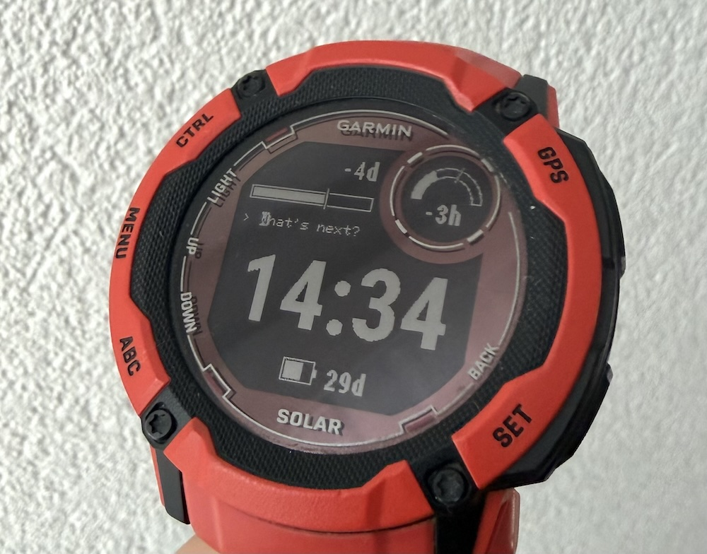
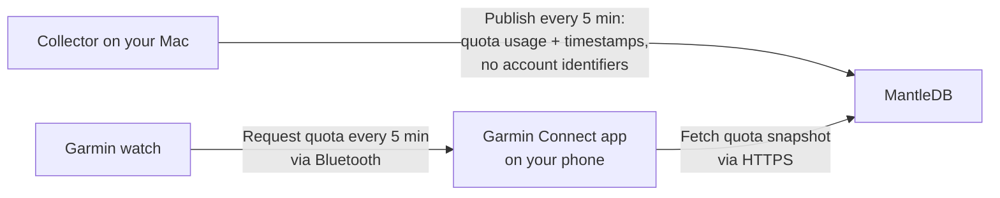

# Token Quota for Garmin Instinct 2X Solar

Check your remaining Codex subscription quota and time until reset from a Garmin Instinct 2X Solar watchface. It shows the five-hour and seven-day quota windows alongside a 24-hour clock and battery level. The included collector supports Codex only; other providers need a collector that produces the [shared payload](quota-payload.md).



## How it works

A Python collector on your Mac reads quota from your signed-in Codex CLI and publishes a snapshot to [MantleDB](https://mantledb.sh/). The watch reads that snapshot through your phone using Garmin Connect.



**Your quota snapshot is public.** Anyone with its URL can read the remaining quota, reset times, and observation time. The collector does not publish prompts, conversations, or Codex authentication credentials. MantleDB receives the snapshot and the write token used to publish it; the token is saved locally in `.local/collector.json` and is not sent to the watch.

The collector and watch each check every five minutes. Readings can approach ten minutes old during normal operation, and sleep or connection problems can delay them further. The Mac must be awake and logged in for collection; the watch needs a Bluetooth connection to a phone with Internet access and Garmin Connect running in the background.

Live reads have been confirmed on a physical Instinct 2X Solar. Ongoing operation with Garmin Connect in the background still needs a hardware check. The included build targets the Instinct 2X; other watch models have not been verified.

## Reading the watchface

- The circular gauge shows five-hour quota; the horizontal bar shows seven-day quota.
- White fill shows quota remaining. The thin outlined marker shows time remaining in the window. Fill extending beyond the marker means quota is ahead of an even spending pace.
- Countdowns show time until reset, rounded down to whole days, hours, or minutes. `-4d`, for example, means at least four days remain.
- `SETUP` means no quota URL is configured. `...` means data is unavailable or a reset is awaiting a new reading. `!` marks a reading at least 15 minutes old.

## Install without the Garmin SDK (macOS)

You need Python 3, a signed-in Codex CLI for the included collector, and the prebuilt signed [TokenQuota.prg](watchface/bin/TokenQuota.prg) for the Instinct 2X included in this repository. You do not need the Garmin SDK, Java, or your own Garmin developer key to install this prebuilt file.

Run the commands below from the project root.

### 1. Set up the collector

```sh
./collector/setup-collector.py
```

This publishes your quota, generates `watchface/bin/TokenQuota.SET`, and starts five-minute updates. On first setup it claims a unique MantleDB namespace; subsequent runs reuse your saved configuration.

Keep this project folder in place. The collector runs while your Mac is awake and you are logged in; rerun setup after moving the folder. Refer to [collector setup](collector/README.md) for logs, custom namespaces, and stopping the schedule.

### 2. Connect the watch

Connect the Instinct 2X by USB and wait for it to appear as a drive. If needed, hold **MENU**, then select **System → USB Mode → Mass Storage** on the watch. Garmin describes these USB modes in the [Instinct 2 Series manual](https://www8.garmin.com/manuals/webhelp/GUID-31D23DBB-57C2-4DF7-A0C9-8D1A00AB4BE7/EN-GB/Instinct_2_Series_OM_EN-US.pdf).

### 3. Deploy and select the watchface

```sh
./watchface/scripts/deploy.sh /Volumes/GARMIN
```

Replace `/Volumes/GARMIN` with the watch’s mount path. The script replaces any existing Token Quota program and settings. It checks both source files, copies the `.prg` to `GARMIN/APPS/` and the `.SET` to `GARMIN/APPS/SETTINGS/`, verifies the copies, and ejects the watch. If either source file is missing, it stops with instructions.

After successful ejection, disconnect the cable and choose **Token Quota** in the watch-face picker. Allow at least five minutes for the first reading; Garmin may delay background requests.

## Project layout

| Path | Contents |
|---|---|
| [watchface/](watchface/README.md) | Monkey C app, Garmin resources, font assets, build and simulator scripts, and visual references |
| [collector/](collector/README.md) | Python quota collector, macOS scheduler, and collector tests |
| [quota-payload.md](quota-payload.md) | JSON payload contract shared by both components |

## Development

Rebuilding or using the simulator requires the Connect IQ SDK with the `instinct2x` device installed, Java, and OpenSSL.

```sh
./watchface/scripts/build.sh       # watchface/bin/TokenQuota.prg
./watchface/scripts/run.sh         # Build and launch the simulator
./watchface/scripts/run.sh --test  # Run simulator tests
```

`--test` builds a separate program containing the watchface code and automated tests, then runs the tests and exits. It is optional; refer to [Simulator tests](watchface/README.md#simulator-tests) for coverage and output.

Normal builds update the bundled `watchface/bin/TokenQuota.prg`. Include the rebuilt program when publishing changes to the watchface source.

## Other collectors

Other collectors can publish the [shared payload](quota-payload.md). If you already have a public quota URL, use [standalone settings generation](watchface/README.md#sideloaded-settings-file) instead of the Codex setup script. `export-settings.py` is only an optional development helper for settings edited in the simulator.

## Local files

Private keys, collector configuration, and logs are stored in `.local/` at the repository root, which `.gitignore` excludes. Do not publish this directory. Generated settings and other build outputs in `watchface/bin/` are ignored; the bundled `TokenQuota.prg` is included in the repository. Keep the existing signing key and collector configuration when moving this project.

## License

This project is available under the [MIT License](LICENSE). The watchface also bundles a generated bitmap font; its source font and separate license are documented in [watchface/assets/fonts/README.md](watchface/assets/fonts/README.md).
